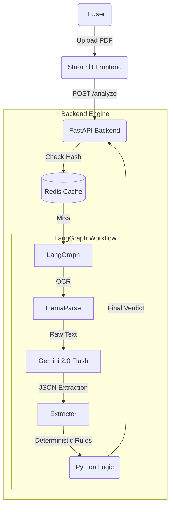

# 🏦 FinDoc AI


**FinDoc AI** is an intelligent financial analysis agent designed to automate the loan underwriting process. It ingests complex, unstructured PDF bank statements, extracts key financial metrics (Salary, EMIs, Balance), and assesses creditworthiness using a **Hybrid Deterministic Architecture**.

Unlike standard "Chat with PDF" tools, FinDoc AI separates **Perception (LLM)** from **Logic (Python)** to ensure 100% mathematical accuracy and auditability.

---

## 🏗️ Architecture

The system follows a **Microservices Pattern**, decoupling the inference engine from the user interface.



## ✨ Key Features

📄 GenAI-Native OCR: Uses LlamaParse to reconstruct complex financial tables from PDFs into Markdown, preserving structure that traditional OCR tools miss.

🧠 Hybrid Logic Core: Delegates unstructured text extraction to LLMs (Gemini) but enforces business rules (DTI calculations, risk scoring) using Pure Python, eliminating "hallucinated math."

⚡ Semantic Caching: Implements Redis to hash and cache analyzed documents, reducing API latency from 15s to 10ms for duplicate requests.

🔄 Self-Correcting Workflow: Uses LangGraph to implement conditional routing—if extraction confidence is low, the system flags the file for human review instead of guessing.

🔌 API-First Design: Built on FastAPI, enabling easy integration into existing banking mobile apps or web portals.

## 🛠️ Tech Stack


| Component        | Technology              | Role |
|------------------|-------------------------|------|
| Orchestration    | LangGraph               | Stateful workflow management (loops, conditions) |
| LLM              | Google Gemini 2.0 Flash | Extraction of unstructured financial data |
| OCR / Vision     | LlamaParse              | Converting PDF tables to structured Markdown |
| Backend API      | FastAPI                 | Asynchronous REST API server |
| Caching          | Redis (Upstash)         | Request deduplication and history storage |
| Frontend         | Streamlit               | Client-side dashboard for testing |
| Validation       | Pydantic                | Strict schema enforcement for data integrity |

## 🚀 Setup & Installation
1. Clone the Repository

```bash
git clone [https://github.com/your-username/FinDoc-AI.git](https://github.com/your-username/FinDoc-AI.git)
cd FinDoc-AI
```
2. Install Dependencies
```bash

pip install -r requirements.txt
```
3. Configure Environment Variables
Create a .env file in the root directory:
```bash
GOOGLE_API_KEY="your_gemini_key"
LLAMA_CLOUD_API_KEY="your_llama_parse_key"
REDIS_URL="your_redis_url" # Optional: For caching
LANGCHAIN_TRACING_V2=true
LANGCHAIN_API_KEY="your_langsmith_key" # Optional: For observability
```

4. Run the Application
You need to run the Backend and Frontend in separate terminals.

Terminal 1: Backend API

```Bash

uvicorn backend.app:app --reload
```
Server will start at http://127.0.0.1:8000

Terminal 2: Frontend UI

```bash
streamlit run frontend/ui.py
```
Dashboard will open at http://localhost:8501

## 🧪 Testing
1. Navigate to the Frontend URL.

2. Upload a bank statement PDF (or use the provided generate_real_pdf.py script to create a dummy one).

3. Click "Analyze Risk".

4. View the extracted Salary, EMIs, and the calculated Risk Score.
