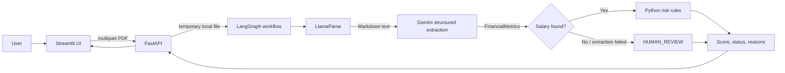

# FinDoc AI

A document-processing prototype that extracts a small set of financial values from a PDF and applies explicit Python rules to produce an underwriting-style score and status. The repository currently accepts one uploaded file per request and supports a Streamlit UI backed by a FastAPI service.

> **Scope:** This is an educational prototype, not a lending decision system or a substitute for a lender's verified policies and review. The score is based only on values extracted from the submitted document and the hard-coded rules below.

## System overview

The implemented path separates document parsing, LLM-based field extraction, and rule-based scoring. LlamaParse converts the PDF into Markdown text; Gemini returns values matching a Pydantic schema; Python computes the score. If parsing or extraction fails, or the extracted monthly salary is zero, the graph ends in `HUMAN_REVIEW`.



There is no Redis client, cache, database, or persistent history in the current implementation. The diagram above reflects the source code. The repository also contains `FINDOCS DIAGRAM.drawio.png`; its contents are not referenced by the application.

## Workflow

1. **Upload:** The Streamlit page sends the selected file as multipart form data to `POST /analyze`.
2. **Temporary file:** FastAPI writes the upload to a `temp_<uploaded filename>` file in the process working directory.
3. **Parse:** `backend/tools.py` calls LlamaParse with Markdown output and combines the returned page text.
4. **Extract:** `backend/chains.py` sends the text to `gemini-flash-latest` through LangChain structured output. The `FinancialMetrics` schema contains monthly salary, total EMIs, closing balance, and optional applicant name. The prompt asks for average recurring salary credits, summed recurring EMI debits, and the latest closing balance; it asks the model to use zero for values not found.
5. **Route:** `backend/graph.py` assigns confidence 1.0 when salary is greater than zero, otherwise 0.4. Confidence below 0.5 routes directly to a placeholder human-review node; it does not pause for a human inside the application.
6. **Score:** With a positive salary, the workflow applies the deterministic rules in `backend/risk_engine.py`.
7. **Respond and clean up:** The API returns the response fields listed below and attempts to delete the temporary file on both success and failure.

### Scoring rules in code

The score starts at 100 and is clamped to the 0–100 range.

| Rule | Effect |
| --- | --- |
| EMI-to-salary ratio greater than 50% | Subtract 40 points |
| Ratio greater than 30% and at most 50% | Subtract 20 points |
| Monthly salary below 25,000 | Subtract 50 points |
| Negative closing balance | Set score to 0 |

The status is `APPROVED` for scores at least 75, `REJECTED` below 50, and `HUMAN_REVIEW` for scores from 50 through 74. These are example constants in the code, not validated lending policy. The calculations are deterministic for the extracted inputs; the extraction itself depends on external parsing and model services.

## Components

| Area | Implementation |
| --- | --- |
| UI | Streamlit in `frontend/ui.py` |
| HTTP API | FastAPI in `backend/app.py`; Uvicorn is the server |
| Workflow | LangGraph nodes and conditional routing in `backend/graph.py` |
| PDF parsing | LlamaParse, configured for Markdown, in `backend/tools.py` |
| Structured extraction | LangChain Google integration with `gemini-flash-latest` in `backend/chains.py` |
| Data/state schemas | Pydantic models in `backend/state.py` |
| Scoring | Plain Python rules in `backend/risk_engine.py` |
| Configuration | `python-dotenv` loads local environment values |
| Persistence/cache | Not implemented |

## Repository layout

```text
.
├── backend/
│   ├── app.py          # FastAPI routes and upload handling
│   ├── chains.py       # Gemini structured extraction chain
│   ├── graph.py        # LangGraph workflow and routing
│   ├── risk_engine.py  # Deterministic score and status rules
│   ├── state.py        # Pydantic metrics and graph state
│   └── tools.py        # LlamaParse PDF-to-text helper
├── frontend/
│   └── ui.py           # Streamlit upload and results page
├── test_graph.py       # Manual workflow smoke script
├── requirements.txt
└── FINDOCS DIAGRAM.drawio.png
```

## Requirements and configuration

Use Python with pip. Dependency versions are not pinned in `requirements.txt`.

1. Clone the repository and enter its directory:

   ```bash
   git clone https://github.com/sharma-piyush1/FinDoc-AI.git
   cd FinDoc-AI
   ```

2. Install dependencies:

   ```bash
   python -m pip install -r requirements.txt
   ```

3. Create a `.env` file in the repository root:

   ```dotenv
   GOOGLE_API_KEY=your_google_api_key
   LLAMA_CLOUD_API_KEY=your_llama_cloud_api_key
   ```

The code reads these two values for Gemini and LlamaParse. Redis and LangSmith variables shown in older documentation are not used by the current source.

## Run locally

Start the API from the repository root:

```bash
uvicorn backend.app:app --reload
```

The API listens at `http://127.0.0.1:8000`; FastAPI's interactive documentation is available at `http://127.0.0.1:8000/docs`.

In a second terminal, start the UI:

```bash
streamlit run frontend/ui.py
```

The UI targets `http://127.0.0.1:8000/analyze` directly. That URL is hard-coded in `frontend/ui.py`.

## API

### `GET /`

Health-style response:

```json
{"message": "FinDoc AI Risk Engine is Running 🚀"}
```

### `POST /analyze`

Accepts a multipart upload with the field name `file`. The UI restricts its picker to PDF files, but the API code itself does not enforce a PDF content type or upload-size limit.

```bash
curl -X POST "http://127.0.0.1:8000/analyze" \
  -F "file=@./statement.pdf;type=application/pdf"
```

Successful workflow response shape:

```json
{
  "applicant_name": "Example Applicant",
  "risk_score": 80,
  "approval_status": "APPROVED",
  "monthly_salary": 50000.0,
  "total_emis": 10000.0,
  "reasoning": []
}
```

The values above are illustrative only. Actual response fields are assembled in `backend/app.py`. The endpoint does not return closing balance, extraction confidence, or the internal extraction error list. Failures that escape the workflow are returned as HTTP 500 with the exception text in `detail`.

## Validation, caching, and failure behavior

- Pydantic defines the extraction fields and constrains graph confidence and risk score ranges. Gemini is asked to produce structured output using that schema.
- The workflow's confidence is a simple salary-present check, not a calibrated confidence measure.
- LlamaParse exceptions are caught and converted to empty text. Extraction exceptions are captured in graph state and route to the human-review placeholder.
- A missing/zero salary routes to `HUMAN_REVIEW`; that route does not invoke the scoring node.
- There is no Redis usage, semantic cache, request deduplication, database, or audit-history storage in the code.
- The API catches broad exceptions and returns HTTP 500. It does not provide specialized validation responses for malformed PDFs or external provider failures.
- Temporary files use the client-provided filename as part of the local path. Deployments should review filename handling, file limits, concurrent uploads, and sensitive-data handling before exposing the service.

## Testing

The repository has one manual script, `test_graph.py`, rather than an automated test suite. It expects a file named `sample_bank_statement.pdf` in the repository root and invokes the live parsing/extraction workflow, so valid API keys and provider connectivity are needed.

```bash
python test_graph.py
```

The expected sample PDF and the generator mentioned in the older README are not present in the tracked source tree. No automated unit or API tests are currently included.

## Deployment and limitations

There is no Dockerfile, compose file, deployment manifest, CI workflow, or production server configuration in the repository. The API can be started with Uvicorn as shown above; this documents local startup, not a production deployment recipe. Provider credentials and access to Google Gemini and LlamaCloud are required for analysis.

Known limitations grounded in the current code:

- Extraction uses a prompt and model output; it is not independently reconciled against statement totals.
- The scoring thresholds are hard-coded example rules and are not configurable.
- The UI is configured for a local API URL.
- No durable storage, cache, authentication, rate limiting, PII redaction, or human-review queue is implemented.
- The API returns only a subset of the internal workflow state.
- `test_graph.py` depends on a local sample PDF that is not included.

## Possible next steps

These are not implemented features: add automated tests with mocked provider calls, enforce upload validation and safe temporary-file handling, make the API URL and scoring rules configurable, add privacy and access controls, and build durable review/audit storage if the intended use requires it.
